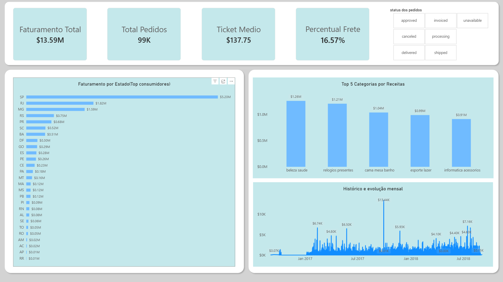

# Laboratorio de Dados: Projeto Pratico (Python / SQL / BI)


Este repositorio foi criado como um projeto para praticar dados e consolidar minhas habilidades fundamentais em analise de negocios, engenharia reversa de dados e automacao com Python. Utilizando o dataset publico do Olist (encontrado no Kaggle), construi um pipeline completo de ponta a ponta (End-to-End) para simular o dia a dia de um profissional de dados: desde a criacao de um banco de dados robusto com arquivos .csv brutos ate a entrega de um dashboard interativo.

---

## Tecnologias Utilizadas e Aprendizados:

### 1. Python (Ambiente de Ingestao e Engenharia)
Utilizado no VS Code com Python 3.13 para automatizar a carga de dados de arquivos CSV brutos diretamente para o banco de dados estruturado.
* Bibliotecas utilizadas: pandas e sqlalchemy / psycopg.
* O que foi feito:
  * Configuracao do ambiente de desenvolvimento profissional integrado ao VS Code.
  * Tratamento de seguranca de credenciais locais (resolucao de conflitos de caracteres especiais em strings de conexao).
  * Automacao de processos repetitivos por meio de loops para conversao em massa e transferencia limpa dos arquivos CSV para um banco de dados onde o PostgreSQL pode acessar.

### 2. SQL & PostgreSQL (Modelagem e Regras de Negocio)
Utilizado via pgAdmin para explorar a integridade dos dados, validar os numeros e criar a camada de consumo ideal antes da etapa de visualizacao.
* O que foi feito:
  * Criacao, gerenciamento e limpeza de bancos de dados relacionais locais.
  * Escrita de queries utilizando multiplos operadores de juncao (JOIN, INNER JOIN) para cruzar tabelas de dimensoes e fatos.
  * Agregacoes completas com operadores matematicos e de agrupamento (SUM, COUNT DISTINCT, AVG, GROUP BY, ORDER BY).
  * Criacao de VIEWs (CREATE OR REPLACE VIEW): Pratiquei o conceito de otimizacao de performance em BI. Ao inves de carregar tabelas separadas para o Power BI, centralizei os dados relevantes em uma VIEW mestre estruturada no proprio banco SQL, economizando memoria e processamento na ferramenta de visualizacao.

### 3. Power BI (Inteligencia de Negocios e DAX)
Utilizado para transformar os dados tratados da VIEW SQL em um produto final visual, interativo e aderente as demandas de nivel executivo.
* O que foi feito:
  * Conexao e integracao direta via conector nativo do Power BI com o servidor local PostgreSQL (localhost).
  * Modelagem e Linguagem DAX: Criacao de medidas calculadas aplicando boas praticas de mercado, como a funcao DIVIDE (tratamento de erros de divisao por zero) combinada com DISTINCTCOUNT e SUM.
  * Design Clean: Aplicacao de conceitos de usabilidade e data-viz, organizando layouts enxutos, removendo poluicao visual (linhas de grade e eixos redundantes), configurando filtros refinados (Top N Categorias) e utilizando tipografias e paletas de cores padrao do mercado corporativo.
  * Analise Temporal: Correcao e tratamento de tipos de dados (conversao de texto para Data/Hora) para plotar graficos de linhas fluidos, continuos e cronologicos que exibem sazonalidade e tendencias.

---

## Resultados Financeiros Validados no Projeto

Para garantir que o pipeline funcionou sem perdas ou corrupcao de dados durante o trajeto, validei os numeros tanto nas queries do SQL quanto nas telas do Power BI:
* Faturamento Total Monitorado: R\$ 13,59 Milhoes.
* Volume de Pedidos Unicos: Mais de 98,6 mil operacoes.
* Ticket Medio Geral: R\$ 137,75 por transacao.
* Indicador de Logistica: O frete representa em media 16,57% do valor do produto.

---

## Estrutura Fisica do Projeto no VS Code

```text
 projeto
  |-- dados/             <-- Arquivos brutos baixados do Kaggle (.csv)
  |-- csv_to_sqlDados.py <-- Script de automacao e carga em Python
  |-- query.sql          <-- Codigos SQL para buscas de dados (Desafio 1)
  |-- query2.sql         <-- Codigos SQL para buscas de dados (Desafio 2)
  |-- query3.sql         <-- Codigos SQL para buscas de dados (Desafio 3)
  |-- query_view.sql     <-- Codigo SQL de criacao da VIEW mestre no pgAdmin
  |-- dashboard.pbix     <-- Arquivo de desenvolvimento do Power BI Desktop
  |-- README.md          <-- Esta documentacao explicativa
```
